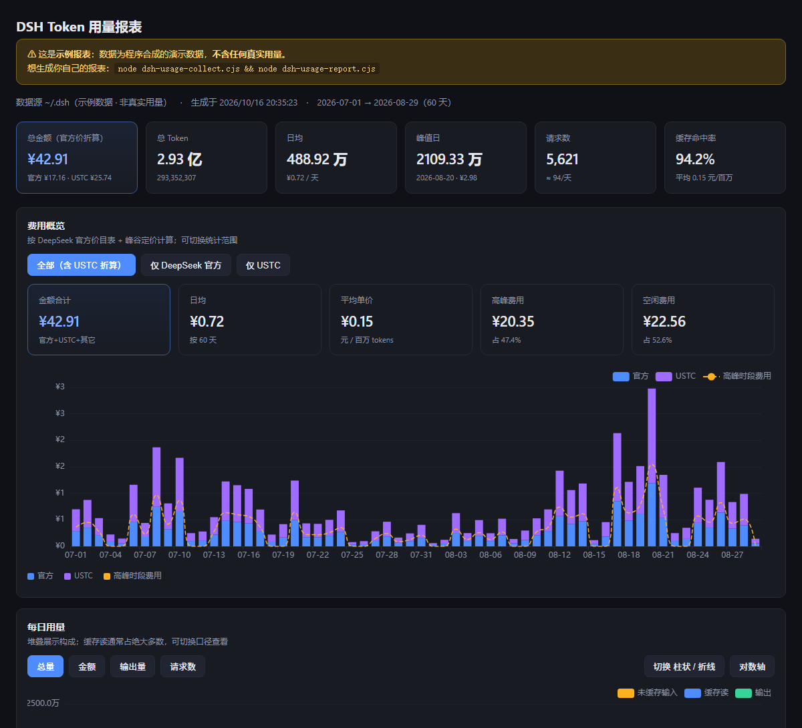

# DSH Token 用量统计

统计 **DeepSeek Harness** 的每日 token 用量，并按 [DeepSeek 官方价目表](https://api-docs.deepseek.com/zh-cn/quick_start/pricing/)（含**峰谷定价**）折算金额，输出一份可双击打开的单文件 HTML 报表。



> 📊 上面是**完整报表**的一个截面（[点这里看整页](docs/screenshot-full.png)），也可用浏览器直接打开
> [`examples/demo-report.html`](examples/demo-report.html) 交互体验。
> 图中均为**合成示例数据**，不含任何真实用量。

---

## 特点

- **零依赖** —— 只用 Node 内置模块（`zlib` 解压 zstd）。不用装任何 npm 包。
- **只读** —— 仅扫描 `~/.dsh` 下的会话日志，绝不写入 DSH 目录。
- **官方计价** —— 完整实现 DeepSeek 峰谷定价：高峰 = 北京时间周一至周五（不含法定节假日）09:00–12:00、14:00–18:00；其余时段（含周末、法定节假日全天）**半价**。
- **多口径** —— 可按 `全部 / 仅 DeepSeek 官方 / 仅 USTC` 切换统计范围。
- **单文件报表** —— 一个 HTML，含堆叠柱状图、输出量折线、日历热力图、可排序明细表。

---

## 快速开始

需要 **Node.js ≥ 22**（用到内置 zstd 解压）。

```bash
# 1. 采集（读取 ~/.dsh，生成中间数据）
node dsh-usage-collect.cjs

# 2. 生成报表
node dsh-usage-report.cjs

# 3. 打开 DSH用量报表.html
```

自定义输出路径：

```bash
node dsh-usage-collect.cjs my-usage.json
node dsh-usage-report.cjs my-usage.json my-report.html
```

若 `DSH_HOME` 不在默认位置，可显式指定：

```bash
DSH_HOME=/path/to/.dsh node dsh-usage-collect.cjs      # Linux / macOS
$env:DSH_HOME="D:\path\to\.dsh"; node dsh-usage-collect.cjs   # PowerShell
```

### 生成示例报表（不读取你的任何数据）

```bash
node dsh-usage-collect.cjs --demo demo.json
node dsh-usage-report.cjs demo.json examples/demo-report.html
```

示例数据是**程序合成的**（固定随机种子，可复现），可安全分享。

---

## 报表内容

| 区块 | 说明 |
|---|---|
| 汇总卡片 | 总金额、总 token、日均、峰值日、请求数、缓存命中率 |
| 费用概览 | 按日堆叠柱（官方 vs USTC）+ 高峰费用虚线；可切换统计范围 |
| 每日用量 | 堆叠柱：未缓存输入 / 缓存读 / 输出；可切**金额**、折线、对数轴 |
| 输出 Token | 单独成图，避免被缓存量级淹没 |
| 活跃热力图 | 按自然周 + 星期对齐 |
| 明细 / 按网关 / 按模型 | 均含金额与占比，表头可排序 |
| 计价规则 | 完整披露价目、峰谷规则、节假日与口径 |

---

## 计价口径

元 / 百万 tokens：

| 模型 | 缓存命中(空闲/高峰) | 缓存未命中(空闲/高峰) | 输出(空闲/高峰) |
|---|---|---|---|
| `deepseek-flash` | 0.02 / 0.04 | 1 / 2 | 4 / 8 |
| `deepseek-v4-pro` | 0.15 / 0.30 | 4.5 / 9.0 | 13.5 / 27.0 |

- **未缓存输入** = 日志里的 `inputTokens`（cache miss）
- **缓存读** = `cacheReadTokens`（cache hit，便宜很多）
- 总量 = 未缓存输入 + 缓存读 + 输出
- 旧模型名 `deepseek-v4-flash*` 按官方说明**按 Flash 价**计费
- 非 DeepSeek 模型（如 `claude-*`）按 Flash 价折算，报表中会标注

> ⚠️ **重要**：如果你通过第三方网关（学校/公司自建端点等）调用，那部分**并不由 DeepSeek 计费**。
> 报表里的「合计」是「若全走官方要花多少钱」的**折算参考值**。
> 想看真实账单口径，请切到 **「仅 DeepSeek 官方」**。

---

## 数据从哪来

DSH 每个会话的持久日志里，每条 `assistant/message` 记录都带 `data.usage` 和毫秒时间戳：

```json
{"type":"assistant/message","seq":18,"time":1790740831471,
 "data":{"turn":1,"step":1,"usage":{
   "inputTokens":2362,"outputTokens":470,
   "totalTokens":9808,"cacheReadTokens":6976}}}
```

因此**无需埋点**，历史用量可完整复原。

原始文件在：

```
~/.dsh/sessions/<workspace-slug>/<session-id>/session.v4.jsonl.zstd
```

### 已处理的坑

实现时踩过并修复的问题，供参考（也提醒你这些格式可能随版本变化）：

1. **会话目录名有两种约定** —— `session-<uuid>` 与裸 `<uuid>`。必须归一化，否则会与投影缓存重复计入（实测导致总量虚高 15%）。
2. **legacy 日志是截断的旧副本** —— `session.jsonl.zstd` 可能只有 v4 的一小部分（实测 541 条 vs 0 条）。**必须 v4 优先**。
3. **归日要用北京时间** —— 用 UTC 会把约 30% 的请求算到前一天；峰谷判定同样依赖北京时间。
4. **zstd 是多帧追加** —— 直接解压只得第一帧（可能只有 206 字节），必须扫魔数 `28 B5 2F FD` 逐帧解压。
5. **旧日志缺 `totalTokens`** —— 需自行用 `input + cacheRead + output` 求和。
6. **投影缓存有重复快照** —— 仅作「日志缺失时兜底」，且须按归一化 UUID 去重。
7. **模型归因** —— 旧会话无 `model/selection`，回退读 `request/header.header.config.model`。

---

## 隐私

- 脚本**只读** `~/.dsh`，不修改任何 DSH 数据。
- 输出中的路径已脱敏为 `~/.dsh`，**不含用户名**。
- 报表只含**聚合数字**（每日 token、金额、模型占比），**不含**会话 ID、标题或对话内容。
- 但报表仍是**你的真实用量**。开源/分享时请勿提交真实数据产物 —— 用 `--demo` 生成示例即可。
- 仓库内的截图与示例报表均来自 `--demo` 合成数据，**不含**真实用量。

> **提示**：若你自己截图分享，注意报表顶部会显示数据源路径与生成时间。
> 路径已默认脱敏为 `~/.dsh`，但仍会暴露你的用量规模与时间分布。

提交前自检：

```bash
node check-no-leaks.cjs
```

会扫描仓库内文件，检查本机路径、用户名、会话 UUID、疑似密钥等。退出码非 0 表示有问题。

---

## 文件说明

| 文件 | 作用 |
|---|---|
| `dsh-pricing.cjs` | 计价引擎：官方价目表 + 峰谷判定 + 模型名映射 |
| `dsh-usage-collect.cjs` | 采集器：扫描日志 → 聚合 JSON（含 `--demo`） |
| `dsh-usage-report.cjs` | 报表生成器：JSON → 单文件 HTML |
| `check-no-leaks.cjs` | 提交前隐私自检 |
| `examples/demo-report.html` | 示例报表（合成数据） |
| `docs/screenshot.png` | README 展示图（示例数据的截图） |
| `docs/screenshot-full.png` | 报表整页截图 |

---

## 已知限制

- **ECharts 走 CDN** —— 离线环境下图表不显示，但卡片与表格仍可用。需要完全离线可自行把 `echarts.min.js` 内联进 HTML。
- **全量扫描** —— 会话多时约数秒（实测 1140 个会话）。尚未做按 mtime 的增量缓存。
- **金额为估算** —— 官方保留调价权利，历史单价可能与当前表不同；报表不猜测历史价。
- **节假日需更新** —— 峰谷判定内置 2026 年法定节假日（中秋 9/25–9/27、国庆 10/1–10/7），跨年请更新 `dsh-pricing.cjs` 中的 `HOLIDAYS_2026` / `MAKEUP_WORKDAYS`。
- 未包含子代理的独立口径（数据里有 `subagentReq` / `subagentTotal` 字段，但报表暂未单独展示）。

---

## License

[MIT](LICENSE)
